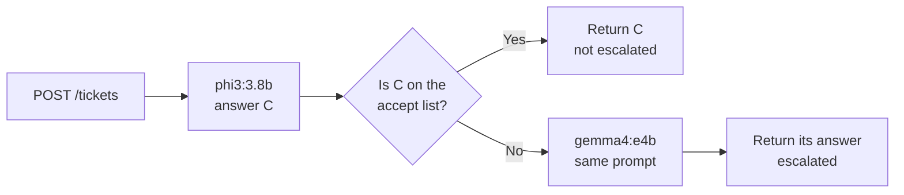
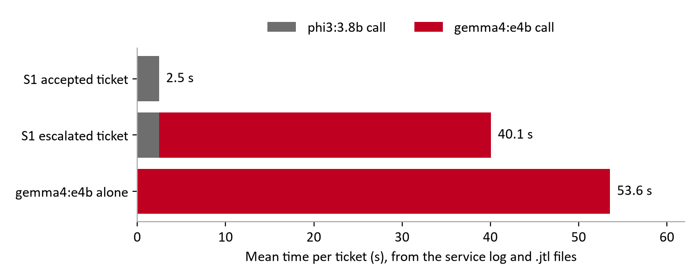
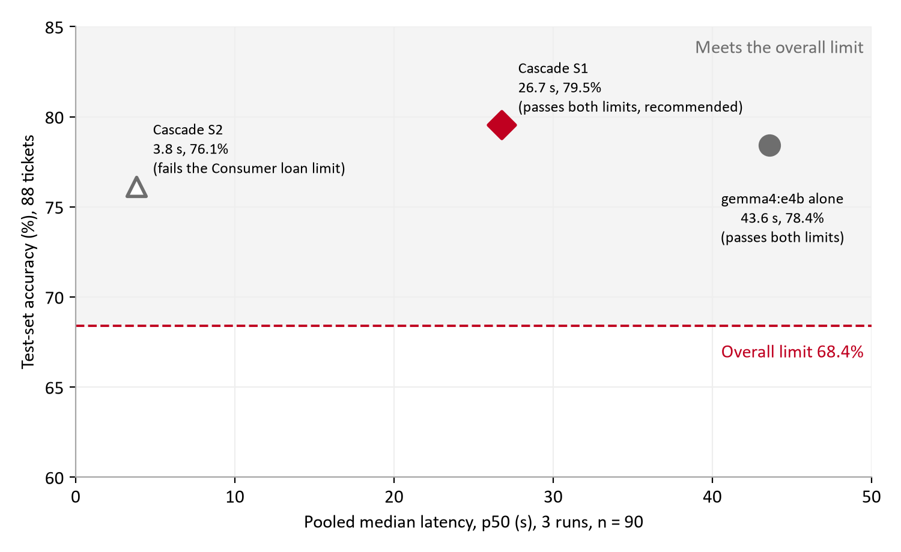

# Assignment 2, Step 5: Recommendation

This document supports slide 7 of the Assignment 2 deck. The two figures are drawn from the raw run files by
`py analysis/a2_tradeoff.py` and `py analysis/a2_latency_breakdown.py`. Both scripts check their figures against
`docs/A2_SPEED_RUNS_SUMMARY.md` and stop on any mismatch.

## Contents

1. [Summary](#1-summary)
2. [Configurations that qualify](#2-configurations-that-qualify)
3. [Speed gain](#3-speed-gain)
4. [Accuracy cost](#4-accuracy-cost)
5. [Why the cascade is faster](#5-why-the-cascade-is-faster)
6. [Why Cascade S2 is excluded](#6-why-cascade-s2-is-excluded)
7. [Escalation fraction](#7-escalation-fraction)
8. [Predictions and outcomes](#8-predictions-and-outcomes)
9. [Limitations](#9-limitations)
10. [Sources](#10-sources)

## 1. Summary

The team recommends **Cascade S1** for deployment.

| Item | Result |
|---|---|
| Configuration | phi3:3.8b answers first. The ticket escalates to gemma4:e4b when phi3 predicts Bank account or service, Credit reporting or Mortgage. |
| Accuracy limits | Passes both the overall limit and every per-category limit on the test set |
| Speed | Fastest of the qualifying configurations. Pooled median latency is 26.7 s, against 43.6 s for gemma4:e4b alone (39% lower). |
| Accuracy cost | None overall (70/88 against 69/88). Bank account or service drops two tickets and sits exactly on its limit. |

The rule is defined in `datasets/a2/escalation_rule.md` and implemented in `server/classifier.py`.

| Setting | phi3's answer is accepted when it predicts | Otherwise the ticket escalates |
|---|---|---|
| S1 (cautious) | Consumer loan, Debt collection, Credit card, Money transfer or service | Bank account or service, Credit reporting, Mortgage |
| S2 (faster) | The S1 list plus Mortgage | Bank account or service, Credit reporting |

## 2. Configurations that qualify

A configuration qualifies when it passes both accuracy limits on the 88-ticket test set:

- the overall limit of at least 61/88 (68.4%)
- every per-category limit

Only two configurations qualify.

| Configuration | Overall accuracy | Per-category limits | Speed-tested | Pooled p50 (n = 90) | Qualifies |
|---|---|---|---|---|---|
| gemma4:e4b alone | 69/88 (78.4%) | Pass | Yes | 43.6 s | **Yes** |
| **Cascade S1** | **70/88 (79.5%)** | **Pass** | Yes | **26.7 s** | **Yes** |
| Cascade S2 | 67/88 (76.1%) | Fail: Consumer loan 5/8, needs 7/8 | Yes | 3.8 s | No |
| mistral:7b alone | 61/88 (69.3%) | Fail: Consumer loan, Bank account, Money transfer | No | Not measured | No |
| phi3:3.8b alone | 58/88 (65.9%) | Fail: Credit card, Consumer loan (overall also fails) | No | Not measured | No |
| llama3.2:1b alone | 25/88 (28.4%) | Fail: six categories | No | Not measured | No |

The brief requires a speed test only for single models that pass the accuracy limits. It requires the cascade to be
speed-tested in every case. No single model other than gemma4:e4b alone passed, so no further speed test was needed.

## 3. Speed gain

All speed figures come from three runs per configuration at 58 tickets per hour, with 30 tickets per run.

| Measure | gemma4:e4b alone | Cascade S1 | Change |
|---|---|---|---|
| Pooled median latency, p50 (n = 90) | 43.6 s | 26.7 s | −16.8 s (−39%) |
| Mean of the three run p50s | 48.8 s (sd 16.2) | 26.8 s (sd 0.6) | −22.0 s (−45%) |
| Pooled p95 (n = 90) | 104.1 s | 64.9 s | −39.2 s (−38%) |
| Mean latency (pooled) | 53.6 s | 23.3 s | −30.3 s (−57%) |
| Errors and unfinished requests | 0 and 0 | 0 and 0 | None |

Cascade S1 is also far more consistent between runs. The spread of its run medians is 0.6 s, against 16.2 s for
gemma4:e4b alone.

## 4. Accuracy cost

Overall, Cascade S1 gives up nothing: 70/88 correct against 69/88 for gemma4:e4b alone. The one-ticket gain lies
within the run-to-run variation of gemma4:e4b on the same rows (67 to 71 out of 88), so it is not claimed as an
improvement.

| Category (test tickets) | gemma4:e4b alone | Cascade S1 | Change | Needed to pass |
|---|---|---|---|---|
| Credit reporting (20) | 17 | 17 | No change | 14 |
| Credit card (16) | 11 | 13 | +12.5 pp | 9 |
| Consumer loan (8, small) | 8 | 8 | No change | 7 |
| Bank account or service (14) | 13 | 11 | **−14.3 pp, exactly on the limit** | 11 |
| Debt collection (9, small) | 4 | 4 | No change | 3 |
| Money transfer or service (17) | 12 | 13 | +5.9 pp | 10 |
| Mortgage (4, small) | 4 | 4 | No change | 4 |

Bank account or service loses two tickets because phi3 labels three of the fourteen Bank account tickets as Credit
card, and S1 accepts Credit card answers.

## 5. Why the cascade is faster

The cascade answers about half of all tickets with the small model alone. Those tickets avoid the much slower large
model.

### 5.1 Time per model call

These timings come from the `small_ms` and `large_ms` fields of the service log, pooled over the three S1 runs.

| Model call | Median | Mean |
|---|---|---|
| phi3:3.8b | 2.0 s | 2.5 s |
| gemma4:e4b, inside the cascade | 34.1 s | 37.6 s |

### 5.2 Checking the brief's formula

The brief gives the mean latency of a cascade as the small-model latency plus the escalation fraction multiplied by
the large-model latency. With 16 of 30 tickets escalated (53.3%), this gives:

> 2.5 s + 0.533 × 37.6 s ≈ 22.5 s

The measured mean was 23.3 s, against 53.6 s for gemma4:e4b alone. The small difference is the routing and queueing
time that the formula ignores.

### 5.3 A caution about the median

S1 escalates 53% of tickets, which is just over half. Its median ticket is therefore one of the fastest escalated
tickets, so its p50 sits on the boundary between two very different groups of times. The mean is the more robust
comparison, and it points the same way: 23.3 s against 53.6 s.

## 6. Why Cascade S2 is excluded

Cascade S2 was the fastest configuration measured, with a pooled p50 of 3.8 s. Only 36.7% of its tickets escalated,
so its median ticket is a phi3 answer.

S2 nevertheless fails the Consumer loan limit, at 5/8 against the required 7/8. The cause is that S2 trusts phi3's
Mortgage answers. Of the 12 test tickets that phi3 labelled Mortgage, only 4 were truly Mortgage. The eight wrong answers it
let through break down as follows:

| True category | Tickets phi3 labelled Mortgage |
|---|---|
| Consumer loan | 3 |
| Credit reporting | 3 |
| Debt collection | 2 |

The brief therefore requires S2 to be reported as not passing accuracy, and it cannot be recommended.

## 7. Escalation fraction

| Setting | Test set (88 tickets) | Speed workload (30 tickets per run) |
|---|---|---|
| S1 | 55/88 (62.5%) | 16/30 (53.3%) |
| S2 | 43/88 (48.9%) | 11/30 (36.7%) |

The service logs confirm that the gap comes from the ticket mix, not from any change in the rule. phi3 predicted Bank
account or Credit reporting for 11 of the 30 workload tickets (37%), against 43 of the 88 test tickets (49%). Both
settings always escalate those two categories.

All three runs of each setting gave identical counts. This is expected, because every run used the same tickets in
the same order, and the model is deterministic (temperature 0, seed 42).

## 8. Predictions and outcomes

The predictions are recorded in `datasets/a2/A2PredictionRecord.pdf`. That file was committed in 10fe162 on 17
November, before the first benchmark run.

### 8.1 Comparison

| Prediction | Measured | Verdict |
|---|---|---|
| The fastest qualifying configuration is gemma4:e4b alone, with a p50 of 34 s | Cascade S1 at 26.8 s, gemma4:e4b at 48.8 s | Wrong |
| S1 escalates 70% (range 55 to 75%), scores 72/88 (range 69 to 75) and has a p50 of 37 s (range 33 to 41 s) | 62.5% ✓, 70/88 ✓, 26.8 s ✗ | Partly right |
| S2 escalates 64% (range 50 to 70%), scores 70/88, passes, and has a p50 of 36 s (range 31 to 41 s) | 48.9% ✗, 67/88 but fails Consumer loan ✗, 3.8 s ✗ | Wrong |
| Escalation under load is 75% for S1 and 65% for S2 | 53.3% and 36.7% | Wrong |
| The largest losses are Consumer loan under S2 (−12.5 pp), then Bank account (−7.1 pp), then Credit reporting under S2 (−5.0 pp) | Consumer loan −37.5 pp, Bank account −14.3 pp, Credit reporting −5.0 pp | Order right, sizes too small |
| No other single model passes the limits | phi3, mistral and llama3.2 all fail | Right |

### 8.2 Why the predictions differed

1. **gemma4:e4b was slower than assumed: 48.8 s against 34 s.** Three factors contributed:
   - The workload tickets were longer than the tickets used to measure S, at a median of 867 characters against
     591.
   - gemma4:e4b reasons before it answers, so longer tickets take it longer.
   - In run 1 a queue built up, because the slowest request took 190.9 s against a 62 s gap between arrivals.

   A slower baseline makes every avoided escalation worth more, which favours the cascade.
2. **The median was harder to predict than assumed.** The prediction treated the median ticket as simply escalated
   or not escalated. In practice, the fastest escalated tickets set the median for S1, and a phi3 answer sets the
   median for S2.
3. **Escalation under load was lower than predicted.** The workload held fewer phi3 answers in the categories that
   are always escalated (37% against 49% on the test set).
4. **The accept lists rested on few tuning answers, between 2 and 20 per category.** phi3 labelled 3 of the 8 test
   Consumer loan tickets as Mortgage, against 2 of 15 on the tuning set. S2 therefore failed the limit instead of
   passing exactly on it.

## 9. Limitations

| Limitation | What it means for the conclusion |
|---|---|
| Test rate below the client peak | The test rate of 58 tickets per hour is about 1.5% of the Assignment 1 client peak (3,936 per hour). The results rank the configurations but do not show that S1 can carry the client's peak load. |
| Small samples | The test set holds 88 tickets, and one ticket is worth 11 to 25 points in the small categories. Each speed run holds 30 tickets. S1's one-ticket lead in accuracy is within noise, and its Bank account result sits exactly on the limit. |
| Seen tickets | Every model already ran on the golden set in Assignment 1. The test set therefore gives a fair comparison but is not new data. |
| One machine and one arrival rate | All results come from one consumer laptop on a mobile hotspot, at a single arrival rate. A different rate could change the ranking. |

## 10. Sources

| Evidence | Location |
|---|---|
| Accuracy runs on the test set | `runs/*_accuracy_a2test88*/` and `analysis/output/a2_accuracy.md` |
| Accuracy limits | `analysis/output/a2_limits.md` |
| Speed runs | `runs/*_speed_{gemmaAlone,cascadeS1,cascadeS2}_run1..3/` (.jtl files, `client_summary.json`, `server_access.log`, `sut_summary.json`) |
| Speed test settings | `datasets/a2/speed/speed_params.json` and `workload_rows.csv` |
| Escalation rule | `datasets/a2/escalation_rule.md` |
| Predictions | `datasets/a2/A2PredictionRecord.pdf` |
| Figures | `analysis/output/figures/a2_tradeoff.png` (from `analysis/a2_tradeoff.py`) and `a2_latency_breakdown.png` (from `analysis/a2_latency_breakdown.py`) |
